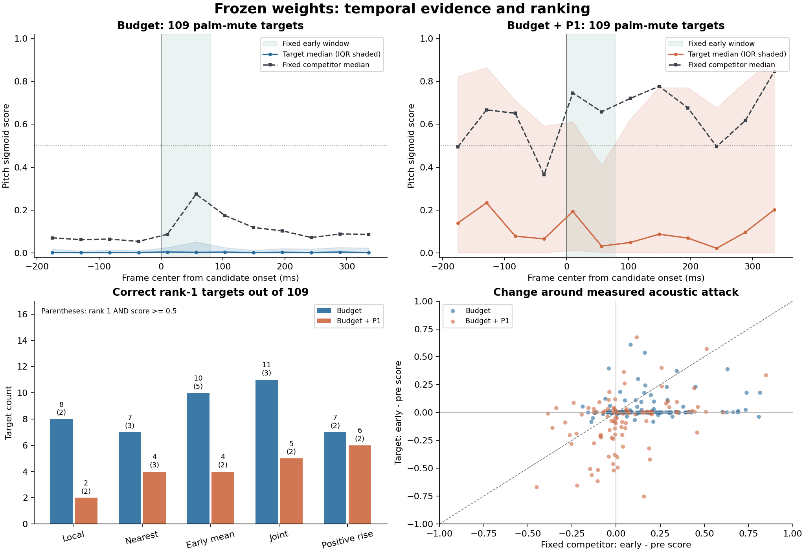

# 固定权重逐帧验证：闷音攻击前后的音高分数

**当前证据不支持仅靠提前取帧解决闷音补全，也不支持扩大训练。**目标音与固定非目标竞争音的攻击响应仍未充分区分；提前取帧的少量排序改善伴随完整标签误报增加。

已完成两个冻结模型的 1,455 组、2,910 条完整推理及独立重放。109 个闷音目标中，按可信声学攻击对齐，目标分数上升的数量分别为 76/109 和 50/109；候选组 0–80ms 均值的首名正确数为 10/4。这两个指标分别说明时间响应与音高区分能力，不能互相替代。

图中上排为候选组起音对齐的逐帧中位数，阴影为目标分数的四分位范围；下排分别为五条规则的首名数、可信声学攻击对齐后的逐样本分数变化。

## 1. 验证边界

权重、音频、候选缓存、发声音高合同、分组、阈值及计算源码均先哈希锁定。没有训练、改标签、换权重或修改生产解码。训练对照仍为原 1,024 组（635 个修正目标）；其中 7 组未确认泛音保留推理，继续屏蔽其标签。内部目标为 150 个（闷音 109、普通拨弦 35、泛音 2、合成样本 4）。完整标签对照为训练 972 组和内部 285 组，共 1,257 组；与内部目标重叠 4 组，因此推理并集为 1,455 组。

输出包含每组全部 56 帧、每帧 49 个音高和起音分数。竞争音固定为前轮已选定的最强非目标，各窗口不重新挑竞争音。排序排除已有候选与同组其他正确目标，保留所有其他音高。

## 2. 攻击前后分数变化

下面按前轮已验证的宽带攻击时刻对齐，比较攻击前 −160～−20ms、攻击后 0～80ms、晚窗 160～320ms。各样本先在窗内取帧均值，再对样本求中位数；“上升量中位数”先逐样本相减，再求中位数。它不等于两个总体中位数之差。

|模型|目标：攻击前 / 早窗 / 晚窗|竞争音：攻击前 / 早窗 / 晚窗|目标上升量中位数|竞争音上升量中位数|目标上升|目标上升超过竞争音|早窗胜过固定竞争音|
|---|---|---|---:|---:|---:|---:|---:|
|固定预算|0.0027 / 0.0036 / 0.0044|0.0698 / 0.2571 / 0.1018|+0.0011|+0.1348|76/109|25/109|11/109|
|固定预算＋P1|0.1979 / 0.0767 / 0.1346|0.4847 / 0.5410 / 0.6273|-0.0002|+0.0042|50/109|32/109|4/109|

早窗目标减固定竞争音的逐样本差值中位数为 -0.2222、-0.2425。P1 组的目标分数平均变化为 -0.0720，较高的目标绝对分数并未转化为更好的竞争优势。

早窗胜过一个固定竞争音仍不足以保证首名：其他缺失候选音高也参与排序。参考起音对齐和候选组起音对齐的完整统计保存在证据中，均使用预先规定的窗口，未做插值。

## 3. 五条固定评分规则

阈值均为 0.5；下表只描述稠密证据的排名和分数。联合规则为 sqrt(早窗音高均值 × 起音最大分数)，正向上升量为早窗最大分数减攻击前均值并截断至 [0,1]。这两条规则未校准，不把诊断分数解释为概率。

|规则|闷音首名：固定预算 / ＋P1|闷音首名且≥0.5|全部内部目标首名（150）|普通拨弦首名（35）|
|---|---:|---:|---:|---:|
|原 local 均值|8 / 2|2 / 2|27 / 13|15 / 8|
|最近帧|7 / 4|3 / 3|21 / 13|13 / 7|
|0–80ms 均值|10 / 4|5 / 2|27 / 14|13 / 7|
|音高 × 起音联合|11 / 5|3 / 2|29 / 15|14 / 7|
|正向上升量|7 / 6|2 / 2|15 / 9|4 / 0|

普通拨弦与闷音的音区差异很大，不能据这张表把差异全归因于技法。实际补全头和数量头没有改变；本轮只检查稠密音高证据，评分规则首名正确不等于已补回。

## 4. 完整标签误报与归属控制

活动真值固定为原 local 四帧的活动并集，四帧都有效才提供负标签；已有候选不参与计数。五条评分规则共用同一真值和掩码。活动 TP 是原 local 时间范围内已知发声音高，本组归属 TP 是应补到当前候选组的目标；两种 FP 含义不同。

|模型|规则|训练活动 TP / FP|训练本组归属 TP / FP|内部活动 TP / FP|内部本组归属 TP / FP|
|---|---|---:|---:|---:|---:|
|固定预算|原 local 均值|582 / 74|236 / 420|2 / 39|2 / 39|
|固定预算|最近帧|604 / 143|209 / 538|1 / 57|1 / 57|
|固定预算|0–80ms 均值|606 / 100|234 / 472|2 / 53|2 / 53|
|固定预算|音高 × 起音联合|306 / 21|140 / 187|2 / 17|2 / 17|
|固定预算|正向上升量|105 / 66|68 / 103|2 / 94|2 / 94|
|固定预算＋P1|原 local 均值|595 / 126|251 / 470|2 / 100|2 / 100|
|固定预算＋P1|最近帧|610 / 202|213 / 599|4 / 179|2 / 181|
|固定预算＋P1|0–80ms 均值|599 / 157|230 / 526|3 / 124|2 / 125|
|固定预算＋P1|音高 × 起音联合|302 / 45|120 / 227|3 / 79|2 / 80|
|固定预算＋P1|正向上升量|101 / 102|73 / 130|2 / 170|2 / 170|

基线活动误报复现：训练 74→126，内部 39→100。内部完整标签 285 组全部来自合成样本，活动正例只有 10 个音高单元；该控制不能代表闷音真实误报率。闷音所属 positive-only 标签未覆盖所有负音高，未标注竞争音不计真实 FP。

## 5. 时间分辨率与解释限制

帧中心间隔为 46.44ms，但仅按幅度通道计算，卷积路径的名义原始音频跨度已约 754.65ms；相位通道另读取前一个 STFT 帧，局部路径跨度可达约 760.45ms。跨时间 GroupNorm 及 2.56 秒整窗 RMS 归一化还使分数依赖更长范围。攻击前的高分不能视为因果提前识别，早晚曲线也不能当作彼此独立的短窗检测。

内部样本已用于此前诊断，不能声称独立泛化。固定权重比较可以定位证据是否随攻击变化，不能单独确认技法因果、训练数据充分性或生产识别率提升。

## 6. 独立复核

- 全部 2,910 条输出重新聚合六项原 HEAD 分数，最大绝对误差 2.0861626e-07，跨 0.5 次数 0，预先规定容差 5e-5。
- 独立重新读取音频、生成特征和推理全部 1,455 组，最大绝对误差 0，跨 0.5 次数 0。
- 人工事件映射核对全部 1,257 个完整标签组的全部帧活动、起音标签与负标签掩码。
- 独立核对 1,570 条目标评分记录、300 条逐帧竞争记录、12,570 条完整标签规则记录及全部汇总。
- 重放沿用已冻结的特征与模型 API；标签映射、五条评分规则、排序和计数由独立脚本实现。
- 初次推理耗时 122.7 秒，独立验证耗时 137.3 秒。原始合同与权重哈希未改变。

## 7. 结果对下一步的约束

固定预算模型中，目标攻击上升量中位数仅 +0.0011，固定竞争音为 +0.1348；只有 25/109 个目标的上升量超过固定竞争音。加入 P1 后，目标攻击上升量中位数约 −0.0002，只有 50/109 个目标上升，攻击早窗胜过固定竞争音的目标仅 4/109。这不支持把 P1 的较高目标分数解释为更准确的攻击响应。

提前取帧将闷音首名从 8→10、2→4，但全部内部目标首名为 27→27、13→14；训练活动误报增加 26、31 个，内部活动误报增加 14、24 个。联合规则将闷音首名变为 11、5，但首名且达固定阈值的只有 3、2；训练活动 TP 同时从 582→306、595→302。它降低误报时也大幅减少检出，不能视为已修复。

下一步适合做固定权重的攻击与上下文干预对照，检验目标和竞争音分数分别依赖哪段音频，并单独控制整窗归一化影响。取得可信归属证据后，再判断是否值得改变编码器或补全头。当前不扩大训练、不切换生产模型。

证据：

- [预注册](pitch-completion-v2-frame-preregistration.md)
- [冻结计划与哈希](apps/api/data/training/pitch-completion-v2-frames-v1/plan.json)
- [完整汇总](apps/api/data/training/pitch-completion-v2-frames-v1/summary.json)
- [独立验证](apps/api/data/training/pitch-completion-v2-frames-v1/verification.json)
- [目标逐帧与固定竞争音](apps/api/data/training/pitch-completion-v2-frames-v1/series.jsonl)
- [全部目标评分](apps/api/data/training/pitch-completion-v2-frames-v1/targets.jsonl)
- [完整标签规则计数](apps/api/data/training/pitch-completion-v2-frames-v1/controls.jsonl)
- [矢量图](pitch-completion-v2-frame-results.svg)
